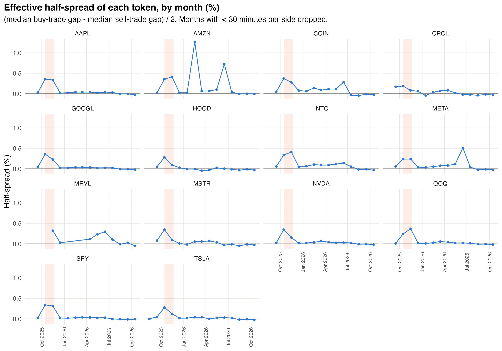
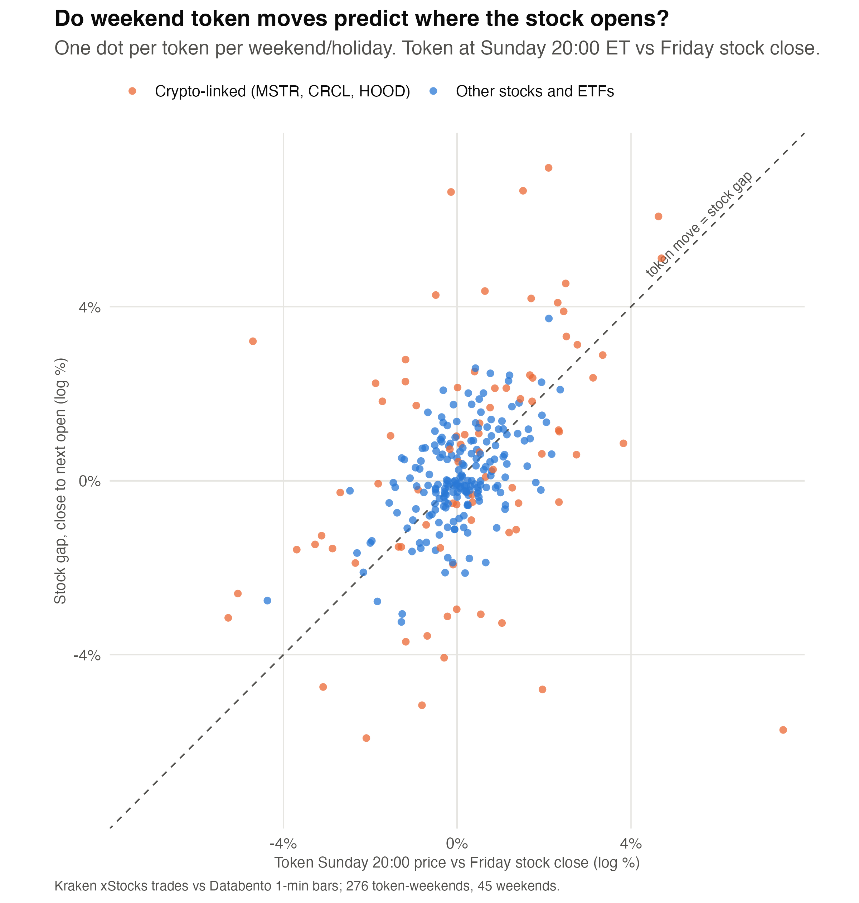
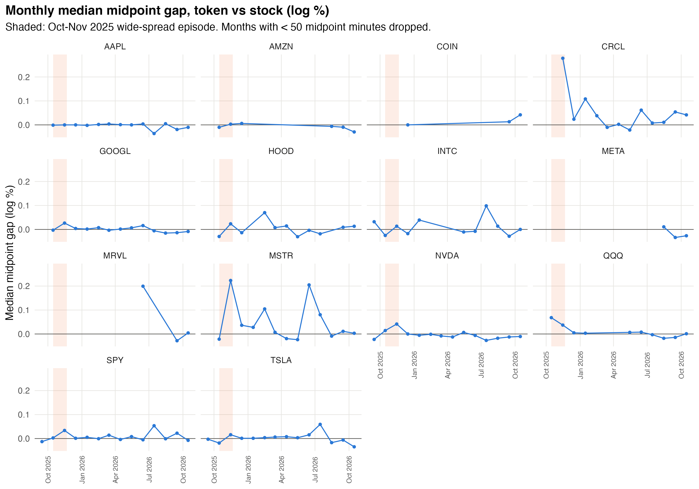

```{r setup, include=FALSE}
knitr::opts_chunk$set(echo = FALSE, message = FALSE, warning = FALSE)
library(data.table); library(knitr)
# All numbers come from output/ (run scripts in README.md order first)
```

# Abstract
<!--
- Question: weekday tracking/arbitrage + off-hours price discovery
- Data: 14 xStocks, every Kraken trade, Databento 1-min bars, Aug 2025 to Oct 2026
- Finding 1: midpoint gap tiny; trade-price gaps mostly spread
- Finding 2: almost nothing outside a no-arb band at realistic fees; half-life ~12 min
- Finding 3: only volatility predicts gaps
- Finding 4: weekend token price weakly related to Monday open; doesn't beat naive forecast
-->

# Introduction
<!--
- What xStocks are; why tokenized stocks matter (24/7 trading, unhedgeable off-hours)
- Two questions: (1) weekday tracking and tradability; (2) closed-market price discovery
- Hypotheses H1-H3, stated as pre-registered (prereg_log.md)
- Preview of results (one line each)
- Contribution / relation to ETF premium literature
- Roadmap of paper
-->

# Background and Related Literature
<!--
- xStocks design: issuer, backing, mint/redeem [secondary sources; label as such]
- Not available to US persons [secondary]
- Kraken trading: fees (app 0% + spread per Kraken; Pro 0.10% taker [secondary])
- Literature (VERIFY each before citing):
  - ETF premiums/discounts and arbitrage (Petajisto)
  - Limits to arbitrage (Gromb and Vayanos)
  - Spread measurement (Roll 1984)
  - Closed-end fund discounts
  - Off-hours / overnight price discovery
-->

# Data
## Token trades (Kraken public API)
<!--
- Endpoint, no key, every trade with side flag; 14 tokens
- Universe rule (>=100 trades/day recently, first trade pre-2026); go/no-go rule failed strictly (19 genuine, 14 pre-2026) -> disclose
- Selection bias: liquid mega-caps + crypto-linked names
-->
## Stock bars (Databento)
<!--
- 1-min OHLCV, regular session; obtained with free-trial credits
- Bar prices are not auction prints (limitation)
-->
## Data quality
<!--
- Duplicates = page boundaries; ids consecutive (no skipped trades); time monotonic
- Activity grows over sample; early months thin
- Weekend halt pattern: AMZN, COIN, INTC, META, MRVL never trade weekends (gaps end Sun 20:00 ET); others start weekend trading mid-Nov to Dec 2025
-->
```{r tab-dq}
# Table 1: kable(fread("output/dq_kraken.csv"))
# Appendix: output/dq_kraken_month.csv, output/dq_stock.csv
```

# Methodology
## Measuring the gap
<!--
- Side-specific gaps: last buy / last sell per minute vs same-minute stock close (log %)
- Midpoint gap: average of latest buy and sell gaps, each <= 5 min old
- Why: single trades include half the spread (motivate with episode)
- Effective half-spread estimator; inside high-low range check
-->
## No-arbitrage band
<!--
- Executable-price test: buy below stock LOW / sell above stock HIGH by c = 2*fee + half-spread
- Fee grid 0 / 0.10 / 0.25%
- Assumptions favour arbitrage (no stock-side costs, no latency, no short constraints)
- Pre-registered close-based version in footnote + why replaced (post-hoc)
-->
## Persistence
<!-- 15-min block medians, within-day AR(1), half-life formula -->
## Determinants
<!--
- Token-day panel; outcome median |midpoint gap|
- Regressors: log trades, realized vol, half-spread, opening share, episode
- Token FE, date FE (main), clustered by date; two-way as check
-->
## Weekend / closed-market test
<!--
- Windows from data; checkpoints C0, K (Sun 20:00), O1
- drift_K = token at K vs Friday stock close; regress Monday gap on drift_K
- Controls: BTC weekend return, SPYx; crypto interaction
- 5 tokens dropped (no weekend trading); main spec changed before results (log)
- Forecast benchmark vs naive; leave-one-window-out
-->

# Results
## The spread episode (Oct-Nov 2025)
<!-- buys ~+0.5%, sells ~-0.5%; data-identified dates; CRCL/MSTR midpoint premium (small N) -->
```{r fig-halfspread, out.width="100%"}
# 
```
## How closely tokens track (H1)
<!-- trade-price vs midpoint gaps by token, episode split -->
```{r tab-mid}
# Table 2: output/mid_summary.csv
# Figure: NEW midpoint-gap dot plot (to make; replaces archived slide)
```
## Is the gap tradable?
<!-- share of minutes/days outside band by fee; outside episodes last 1-2 min -->
```{r tab-band}
# Table 3: output/band.csv (episode == FALSE, fee 0.10 and 0.25)
```
## Persistence
```{r tab-pers}
# Table 4: output/persistence.csv
```
## What predicts the gap (H2)
<!-- volatility robust; liquidity vanishes with date FE; spread/episode collinear; noisy half-spread -->
```{r tab-det}
# Table 5: output/determinants_table.csv
```
## Off-hours price discovery (H3)
<!--
- Main slope 0.48; drops with controls (same-sample check shows controls, not sample)
- Robustness table; midpoint lowers slope (not attenuation)
- MSE vs naive: no significant improvement
- Monday 04:00 slope 0.76: likely imports overnight-venue info (unverified)
-->
```{r fig-weekend, out.width="80%"}
# 
# Table 6: output/weekend_robust.csv
```
## Dividend / total-return check
```{r fig-mid-monthly, out.width="100%"}
#   # no upward drift for SPY/QQQ/AAPL
```

# Discussion
<!--
- Main friction = cost of trading the token, not mispricing
- Who could arbitrage: retail can't redeem; APs bear redemption delay; US persons excluded
- Weekend: token moves too large relative to Monday gap; liquidity disappears when unhedgeable
-->

# Limitations
<!--
- Sample selection (liquid names); 14 tokens; early thin months
- Bar prices not auction prints; up to 60 s timing mismatch (may inflate volatility effect)
- Half-spread estimator unreliable when spreads tiny (negative Aug-Oct 2026)
- Episode dates and band refinement are post-hoc (disclosed)
- Weekend inference: 32-45 clusters; fee and mint/redeem figures secondary
- No futures/overnight-venue control
-->

# Conclusion
<!-- answer each question in one line; future work: lead-lag with 1-min data, wider universe, futures control -->

# References

# Appendix
<!--
- A: Data quality tables (dq_kraken_month, dq_stock)
- B: Pre-registration log summary + list of post-hoc changes
- C: Pre-registered close-based band results
- D: Reproducibility: README run order, packages
-->
